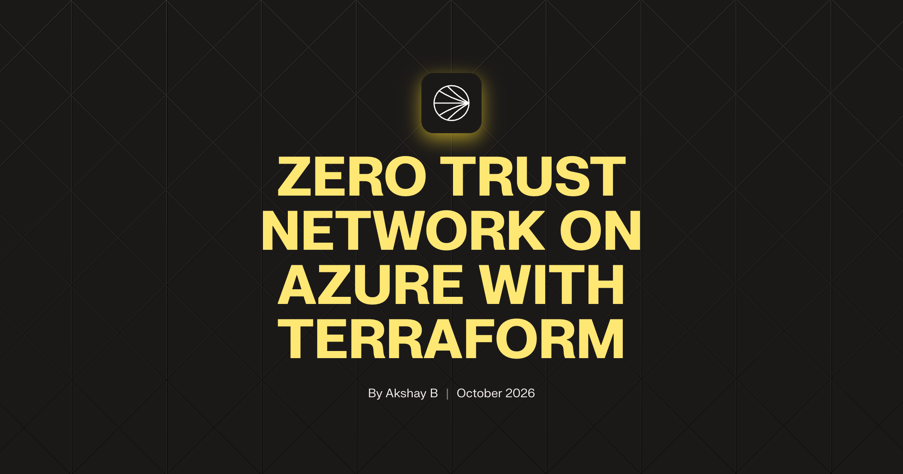
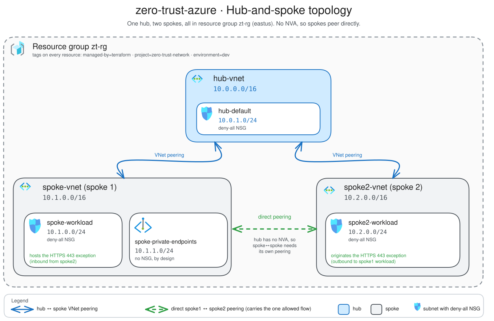
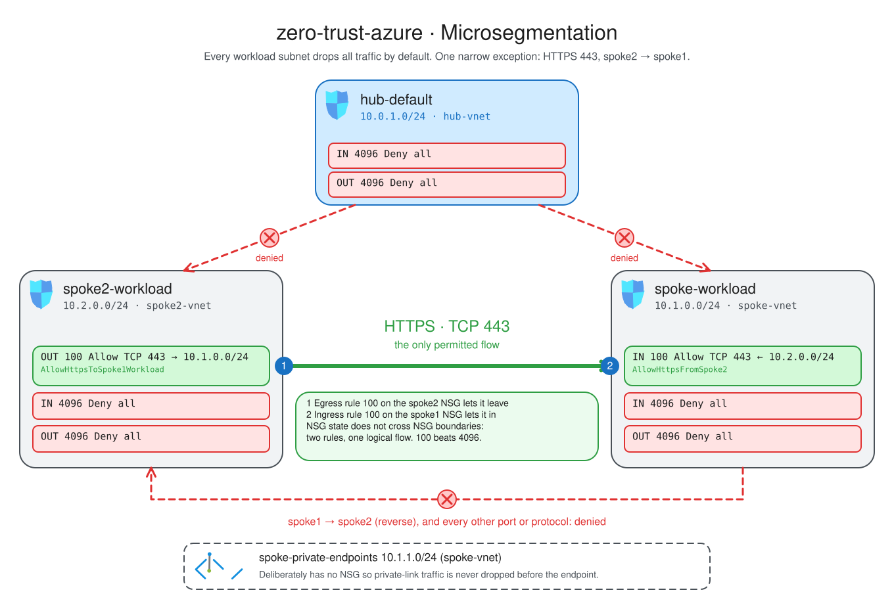
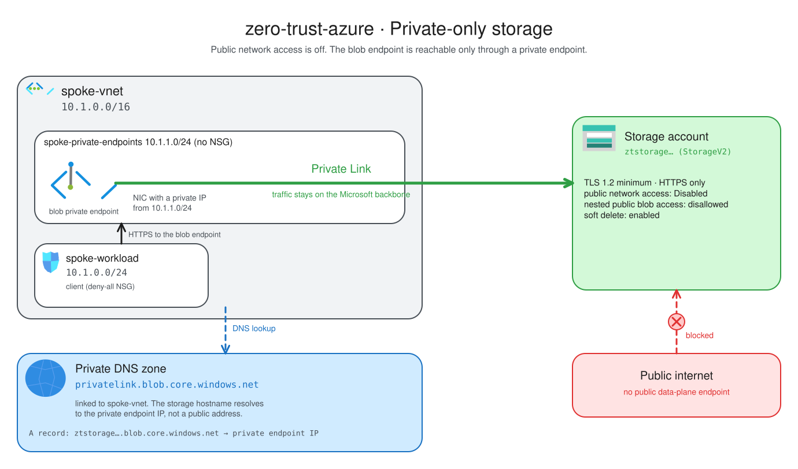
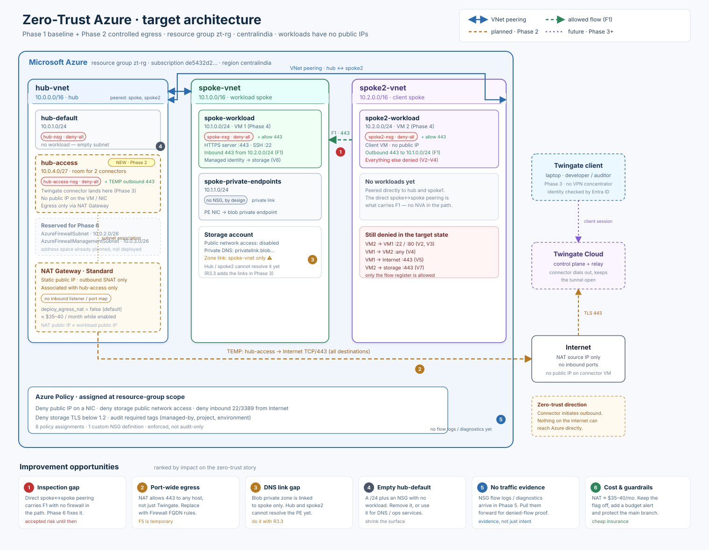
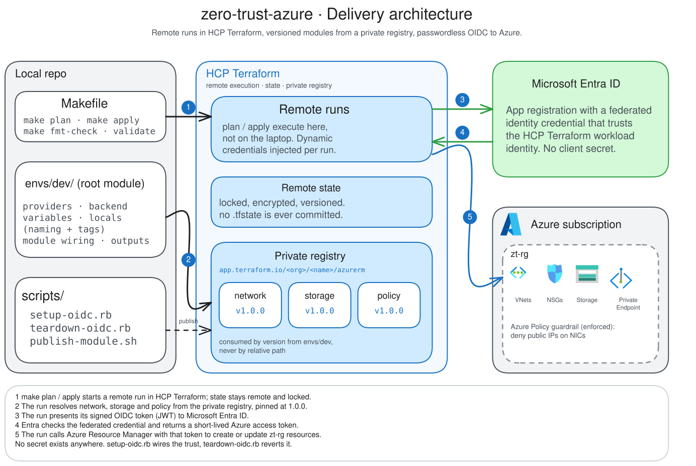

<div align="center">

# Zero-Trust Azure Network

**A default-deny, hub-and-spoke network on Microsoft Azure — built as reusable Terraform modules and deployed through HCP Terraform with remote state and secretless OIDC authentication.**

[](LICENSE)
[](https://www.terraform.io)
[](https://registry.terraform.io/providers/hashicorp/azurerm)
[](https://app.terraform.io)
[](#security-posture)

[Architecture](#architecture) ·
[Microsegmentation](#microsegmentation) ·
[Build walkthrough](#build-walkthrough) ·
[Getting started](#getting-started) ·
[Modules](#modules-and-the-private-registry) ·
[Security](#security-posture) ·
[Inputs & outputs](#inputs)



<sub>Built for the <a href="https://nextwork.ai/projects/9627fa86-3b65-4e7e-a83c-69105c804da2">NextWork “Zero Trust Network on Azure with Terraform”</a> project · by <strong>Akshay B</strong></sub>

</div>

---

## Overview

This project builds a small but production-shaped network on Azure the way a
platform team would: a **hub-and-spoke fabric** where every workload subnet is
**deny-all by construction**, a **private-only storage workload** reachable
solely through a Private Link endpoint, and an **enforced policy guardrail**
that blocks network interfaces from getting public IPs.

Rather than one flat configuration, the fabric lives in **versioned Terraform
modules** (`network`, `storage`, `policy`) published to the **HCP Terraform
private registry** and consumed by the environment root, which runs remotely
with **remote state** and authenticates to Azure through **OIDC — no stored
client secret anywhere**.

The result is an environment where the secure path is the default path, and
every exception is explicit, reviewed and visible in one place.

## Table of contents

- [Architecture](#architecture)
- [Microsegmentation](#microsegmentation)
- [Private data plane](#private-data-plane)
- [Delivery and authentication](#delivery-and-authentication)
- [What it builds](#what-it-builds)
- [Build walkthrough](#build-walkthrough)
- [Repository layout](#repository-layout)
- [Getting started](#getting-started)
- [Modules and the private registry](#modules-and-the-private-registry)
- [Authentication (OIDC)](#authentication-oidc)
- [Security posture](#security-posture)
- [Inputs](#inputs)
- [Outputs](#outputs)
- [Skills demonstrated](#skills-demonstrated)
- [Reflections and takeaways](#reflections-and-takeaways)
- [License](#license)

## Architecture



*One hub and two spokes inside `zt-rg`. The hub carries no NVA, so the two
spokes peer directly when they need to talk. Every workload subnet sits behind
its own deny-all NSG.*

| Component | CIDR | Subnets |
|---|---|---|
| `hub-vnet` — the hub | `10.0.0.0/16` | `hub-default` `10.0.1.0/24`, `hub-access` `10.0.4.0/27` |
| `spoke-vnet` — spoke 1 | `10.1.0.0/16` | `spoke-workload` `10.1.0.0/24`, `spoke-private-endpoints` `10.1.1.0/24` |
| `spoke2-vnet` — spoke 2 | `10.2.0.0/16` | `spoke2-workload` `10.2.0.0/24` |

The design separates **network segments** (VNets and subnets) from
**policy** (security groups and Azure Policy), so a new segment can be added by
extending the module inputs without touching the rules that guard the others.

### Design principles

- **Default deny by construction.** Every workload subnet has an NSG that drops
  all inbound *and* outbound traffic at priority `4096`; nothing is reachable
  unless a higher-priority rule says so.
- **Private by default.** No public data-plane endpoints. The storage account
  has public network access disabled and is reachable only through a private
  endpoint.
- **Guardrails, not conventions.** An enforced Azure Policy assignment rejects
  NICs with public IPs, so the environment can't quietly drift back to public
  exposure.
- **Exceptions are explicit.** East-west, a single narrowly-scoped flow — HTTPS
  `443` from spoke2 to spoke1 — crosses the segment boundary. The only
  internet-bound exception is a temporary, off-by-default HTTPS egress rule on
  `hub-access`, removed when Azure Firewall lands in Phase 6.

## Microsegmentation



*Deny-all everywhere, with exactly one allowed flow: HTTPS `443` from
`spoke2-workload` to `spoke-workload`. It is expressed as two coordinated rules
at priority `100` — an egress allow on spoke2 and an ingress allow on spoke1 —
because NSG state does not cross NSG boundaries. Both beat the `4096` deny-alls.*

The single logical flow is expressed as two rules and one route:

| Element | Type | Where |
|---|---|---|
| `AllowHttpsToSpoke1Workload` | outbound allow, priority 100 | spoke2 NSG |
| `AllowHttpsFromSpoke2` | inbound allow, priority 100 | spoke1 NSG |
| `spoke_to_spoke2` / `spoke2_to_spoke` | VNet peering pair | both VNets |

A direct peering is required because a hub-and-spoke topology alone does not
route between spokes without a network virtual appliance (NVA). Everything else
stays default-deny on both spokes — this is the pattern to copy when adding a
third workload segment.

## Private data plane



*The storage account's public network access is disabled. Its blob endpoint
resolves through `privatelink.blob.core.windows.net` to a private endpoint in
`spoke-private-endpoints`, so it is reachable over the private address space
only.*

- **Hardened storage account** — StorageV2, TLS 1.2 minimum, HTTPS-only, public
  network access disabled, nested (public) blob access disallowed, soft delete
  enabled for blobs and containers.
- **Private endpoint** — the blob service is published into
  `spoke-private-endpoints`; its private IP is exported from the private service
  connection.
- **Private DNS** — `privatelink.blob.core.windows.net` is linked to the spoke
  VNet so the storage FQDN resolves to the endpoint's private IP.

The private-endpoints subnet is intentionally left **without** an NSG so
private-link traffic is not dropped before it reaches the endpoint.

## Controlled egress (Phase 2)



*The Twingate connector gets its own `hub-access` subnet, a deny-all NSG, and an
optional NAT Gateway. The only permitted outbound flow is TCP `443` from that
subnet to `Internet` — a documented temporary exception, not a default.*

- **`hub-access` (`10.0.4.0/27`)** — a dedicated connector subnet, separate from
  `hub-default`, so the connector's egress exception and future inbound rules
  cannot widen the hub's policy.
- **`hub-access-nsg`** — same default-deny baseline as every other subnet. It
  carries one conditional outbound rule, `AllowHttpsToInternet`, enabled only
  while NAT is the egress path. The rule is listed as accepted exception **F5**
  and allow-listed in the network module's wildcard-rule check.
- **`module.egress` (v0.1.0)** — a Standard NAT Gateway with one static Standard
  public IP, associated only with `hub-access`. The IP is an outbound SNAT
  address attached to the gateway, not to a NIC or VM; it has no listener and
  does not make the subnet reachable from the internet.
- **Off by default** — `deploy_egress_nat` defaults to `false` because the
  gateway and public IP cost roughly **$35–40/month**. Enabling it also enables
  the F5 rule, so the exception cannot exist without the egress path that
  justifies it.

This is an interim control. [ADR-006](docs/adr/ADR-006-nat-then-firewall.md)
records why NAT comes before Azure Firewall and defines the Phase 6 removal
trigger: firewall application rules for the Twingate FQDNs replace both the NAT
Gateway and the destination-wide HTTPS allow.

## Delivery and authentication



*`make plan` and `make apply` run remotely in HCP Terraform. Modules are pulled
from the private registry at a pinned version. HCP Terraform authenticates to
Azure through Microsoft Entra ID using OIDC federation — no client secret exists
anywhere.*

- **Remote runs and state** — HCP Terraform (Terraform Cloud) executes plans and
  applies; state lives there and is never committed.
- **Versioned modules** — the environment root consumes `network`, `egress`,
  `storage` and `policy` by version from the private registry, not by relative
  path.
- **Secretless auth** — dynamic provider credentials via OIDC federation; the
  workspace holds no long-lived Azure credential.

## What it builds

| Resource | Notes |
|----------|-------|
| Resource group | `zt-rg`, managed by Terraform |
| `hub-nsg`, `hub-access-nsg`, `spoke-nsg`, `spoke2-nsg` | default-deny inbound **and** outbound |
| `hub-vnet` `10.0.0.0/16` | the hub network |
| `spoke-vnet` `10.1.0.0/16` | first workload network |
| `spoke2-vnet` `10.2.0.0/16` | second, isolated workload segment |
| `hub-default`, `hub-access`, `spoke-workload`, `spoke2-workload` | subnets with the NSGs associated |
| `spoke-private-endpoints` | open subnet reserved for private endpoints |
| bidirectional peering | hub↔each spoke, plus a direct spoke1↔spoke2 pair |
| HTTPS allow (spoke2 → spoke1) | the one east-west exception to default-deny: `443` to the spoke1 workload subnet |
| NAT Gateway + static public IP | optional (`deploy_egress_nat`), associated only with `hub-access`; outbound SNAT with no inbound path |
| HTTPS allow (`hub-access` → `Internet`) | temporary F5 exception, enabled only with the NAT Gateway and removed in Phase 6 |
| `ztstorage` | StorageV2, TLS 1.2+, HTTPS-only, public access disabled |
| `privatelink.blob.core.windows.net` | private DNS zone, linked to the spoke VNet |
| `pe-storage-blob` | private endpoint + DNS zone group |
| `deny-public-ip-on-nic` | Azure Policy assignment, enforced; denies NICs with a public IP |

## Build walkthrough

The project was built in six stages, each adding a layer of the Zero Trust
posture. The full step-by-step journal — with the reasoning and screenshots from
each stage — is in [`docs/WRITEUP.md`](docs/WRITEUP.md).

| Stage | What I built | Key takeaway |
|-------|--------------|--------------|
| **1. Architecture intent** | Framed the whole design around "nothing is trusted by default". | Zero Trust is a *default*, not a set of add-ons — every allowance must be explicit. |
| **2. Setup & Azure auth** | Terraform + HCP Terraform workspace, `azurerm` pinned at `4.81.0`, OIDC federation to Azure. | **Version pinning** guarantees reproducible runs; **OIDC** removes the stored secret entirely. |
| **3. Hub-spoke network** | One hub, two spokes, and a deny-all NSG on every workload subnet. | Deny-all **enforces "assume breach"** — unlisted traffic is treated as hostile. |
| **4. Private storage** | Storage account with public access disabled, a private endpoint, and a linked private DNS zone. | The private endpoint gives the account a **private IP inside the VNet**, so the NSGs actually protect the data. |
| **5. Policy guardrail** | An enforced Azure Policy assignment denying public IPs on NICs. | Policy enforces on the **control plane at deploy time**; NSGs enforce on the **data plane at runtime** — defense in depth. |
| **6. Second spoke & microsegmentation** | A second isolated spoke with a single priority-`100` HTTPS allow above the `4096` deny-all. | **Priority ordering** makes microsegmentation the default: one narrow allow, everything else denied. |

## Repository layout

```
.
├── modules/
│   ├── network/    hub + two spoke VNets, subnets, default-deny NSGs, peerings
│   ├── storage/    private storage account, blob private endpoint, private DNS zone
│   └── policy/     resource-group policy assignment (guardrails)
├── envs/
│   └── dev/        the dev environment root: providers, backend, variables,
│                   locals (naming + tags), module wiring and outputs
├── scripts/
│   ├── setup-oidc.rb        wire HCP Terraform ↔ Azure OIDC federation
│   └── teardown-oidc.rb     reverse the OIDC setup
├── docs/
│   ├── ARCHITECTURE.md      technical reference: topology, modules, state
│   ├── WRITEUP.md           step-by-step build journal (the NextWork project)
│   ├── cover.png            project cover image
│   └── diagrams/            Excalidraw-exported architecture diagrams (SVG)
├── Makefile
└── README.md
```

Each module is self-contained: it declares its own inputs and outputs, takes a
`naming` object so names live in one place, and tags everything it creates.

## Getting started

### Prerequisites

- [Terraform](https://developer.hashicorp.com/terraform/install) `>= 1.9`
- An [HCP Terraform](https://app.terraform.io) organization and workspace
- An Azure subscription and the [`az` CLI](https://learn.microsoft.com/cli/azure/) (for the OIDC helper script)
- `make`

### Configure

1. Set your organization in `envs/dev/backend.tf`, then log in and initialize:

   ```bash
   terraform login        # once, to authenticate the CLI to HCP Terraform
   make init
   ```

2. Copy the example variables and fill in your values (git-ignored):

   ```bash
   cp envs/dev/terraform.tfvars.example envs/dev/terraform.tfvars
   ```

Wired the workspace to Azure already? Jump to [deploy](#deploy). Otherwise run
the [OIDC setup](#authentication-oidc) first.

### Deploy

```bash
make fmt        # terraform fmt -recursive
make validate
make plan       # remote run in HCP Terraform
make apply
```

Run `make` on its own to list every target:

```
Usage:
  make <target>

Targets:
  help          Show this help
  init          Install providers/modules and configure the backend
  fmt           Format all Terraform files
  fmt-check     Fail if any file is not formatted
  validate      Validate the environment configuration
  plan          Show the pending changes
  apply         Apply the pending changes
  destroy       Destroy the environment
```

## Modules and the private registry

The root module consumes the shared modules from the HCP Terraform **private
registry**, pinned by version:

```hcl
module "network" {
  source  = "app.terraform.io/<org>/network/azurerm"
  version = "1.2.0"
}
```

This is why remote runs work: the modules are resolved over the registry instead
of being uploaded from a path outside the configuration directory. The
`modules/` directory in this repo remains the source of truth for those registry
entries.

The registry entries are **VCS-backed**: each module is connected to this GitHub
repository, scoped to its own source directory and git tag prefix. Pushing a
matching tag publishes that version automatically — there is no upload step.

| Module | Source directory | Tag prefix | Release tag |
|---|---|---|---|
| `network` | `modules/network` | `network-` | `network-vX.Y.Z` |
| `egress` | `modules/egress` | `egress-` | `egress-vX.Y.Z` |
| `storage` | `modules/storage` | `storage-` | `storage-vX.Y.Z` |
| `policy` | `modules/policy` | `policy-` | `policy-vX.Y.Z` |

To release a new module version, push its tag:

```bash
git tag network-v1.2.0                      # or egress-* / storage-* / policy-*
git push origin network-v1.2.0
```

Then point the root at the new version (`envs/dev/main.tf`), re-init and plan:

```bash
terraform -chdir=envs/dev init -backend=false
make plan
```

## Authentication (OIDC)

The workspace authenticates to Azure with **HCP Terraform dynamic credentials
(OpenID Connect)** — no stored client secret. `scripts/setup-oidc.rb` wires both
halves: the Azure app registration and federated identity credentials, and the
workspace environment variables.

```bash
scripts/setup-oidc.rb \
  --subscription <sub-id> --tenant <tenant-id> \
  --dry-run          # preview, then drop --dry-run to apply
```

The script grants the principal **two** roles at subscription scope by default:

| Role | Why it is needed |
|------|------------------|
| `Contributor` | create and manage the resource group, the network fabric and the storage account |
| `Resource Policy Contributor` | create the Azure Policy assignments (`Microsoft.Authorization/policyAssignments/write`) |

`Contributor` deliberately excludes `Microsoft.Authorization/*`, so a principal
holding only that role will apply the network and storage fine and then fail the
policy assignment with:

```
403 Forbidden ... AuthorizationFailed ... does not have authorization to perform
action 'Microsoft.Authorization/policyAssignments/write'
```

Override the set with `--role "Role A,Role B"` (repeatable, or comma-separated)
if your design needs different rights. Role assignments can take a few minutes
to propagate; if a fresh apply still returns 403, wait and re-run.

To undo it (delete the app registration and the workspace variables):

```bash
scripts/teardown-oidc.rb --dry-run   # preview
scripts/teardown-oidc.rb             # prompts for confirmation; --yes to skip
```

## Security posture

- **Default deny** — all four NSGs drop all inbound and outbound traffic unless
  a higher-priority rule allows it.
- **Microsegmentation** — each spoke is isolated by its own deny-all NSG. spoke2
  reaches spoke1's workload subnet over HTTPS (`443`) and nothing else; a third
  segment follows the same pattern.
- **No public data plane** — the storage account has public network access
  disabled; it is reachable only through the private endpoint, and only from the
  peered network.
- **Private name resolution** — `privatelink.blob.core.windows.net` is linked to
  the spoke VNet so the storage FQDN resolves to the endpoint's private IP.
- **Guardrail** — the enforced `deny-public-ip-on-nic` policy rejects any NIC in
  the resource group that has a public IP, preventing drift away from the
  private design.
- **Guardrail scope** — the policy targets `Microsoft.Network/networkInterfaces`.
  It blocks a public IP from being *attached* to a NIC, which is what makes a
  workload publicly reachable. It does **not** block creating a standalone
  `Microsoft.Network/publicIPAddresses` resource: an unattached public IP is
  inert, and Azure evaluates the policy at NIC creation. Blocking that resource
  type outright is a deliberate non-goal here and would need a separate
  `Not allowed resource types` assignment.
- **Secretless** — the deploying principal is an OIDC service principal; no
  client secret is stored in the repository, the workspace, or CI.
- **Policy guardrails** — enforced assignments deny public network access,
  plain-HTTP and sub-TLS-1.2 storage, and NSG rules that open inbound SSH/RDP to
  the internet. `managed-by`, `project` and `environment` tag policies start as
  Audit and can be promoted to Deny once the estate is clean.

### Accepted exceptions

Everything not listed here is denied by the default-deny NSGs. Each entry is a
deliberate hole with a named exit condition; new holes go in this table in the
same change that adds them.

| ID | Flow | Why it exists | Exit condition |
|---|---|---|---|
| **F1** | `spoke2-workload` → `spoke-workload` TCP `443` | Demonstrates microsegmentation across segments without a hub NVA: the two spokes peer directly and exactly one workload flow is allowed. | Phase 6 routes inter-spoke traffic through Azure Firewall; the direct peering and both `443` rules are removed. |
| **F5** | `hub-access` → `Internet` TCP `443` | The Twingate connector initiates outbound connections and has no public IP. NAT Gateway provides the path; the NSG cannot express the vendor's FQDNs, so the allow is destination-wide. | Phase 6 replaces NAT with Azure Firewall application rules for the Twingate FQDNs. The rule, its allow-list entry, and `deploy_egress_nat` are removed together. |

F5 is off by default. It is created only when `deploy_egress_nat = true`, so the
exception and the billable egress path are enabled and removed as one unit.

## Continuous integration

`.github/workflows/ci.yml` runs on pull requests and on pushes to `master`:

| Job | Runs | Needs a token? |
|-----|------|----------------|
| `fmt` | `terraform fmt -recursive -check` | no |
| `validate` | `terraform validate` for every module (`-backend=false`) | no |
| `test` | `terraform test` for every module; provider-mocked and offline | no |
| `tflint` | `tflint --recursive` with the azurerm ruleset | no |
| `checkov` | Checkov with the justified-skip list in `.checkov.yaml` | no |
| `plan` | `terraform plan` against the HCP Terraform workspace | yes |

The plan job uses the `TF_TOKEN` repository secret (exposed as
`TF_TOKEN_app_terraform_io`). Because `envs/dev` uses the HCP Terraform cloud
backend, the plan executes as a **remote speculative run** — Azure credentials
stay in the workspace (OIDC), and nothing in CI can apply. The plan output is
posted to the workflow step summary.

One-time setup:

```bash
gh secret set TF_TOKEN   # paste an HCP Terraform user/team token
```

Run the same gates locally:

```bash
make check     # fmt-check + validate-modules + test + lint + security
make hooks     # install the pre-commit hooks (fmt, validate, tflint, terraform-docs)
```

## Inputs

| Name | Description | Default |
|------|-------------|---------|
| `subscription_id` | Target Azure subscription | — |
| `location` | Azure region | `eastus` |
| `environment` | Environment name used in tags | `dev` |
| `storage_account_name` | Globally unique storage account name | — |
| `hub_address_space` | Hub VNet address space | `["10.0.0.0/16"]` |
| `spoke_address_space` | Spoke VNet address space | `["10.1.0.0/16"]` |
| `hub_default_subnet_prefix` | Hub default subnet | `10.0.1.0/24` |
| `hub_access_subnet_prefix` | Connector subnet in the hub | `10.0.4.0/27` |
| `deploy_egress_nat` | Deploy NAT Gateway and the temporary F5 egress rule | `false` |
| `spoke_workload_subnet_prefix` | Spoke workload subnet | `10.1.0.0/24` |
| `spoke_pe_subnet_prefix` | Spoke private-endpoints subnet | `10.1.1.0/24` |
| `spoke2_address_space` | Second spoke VNet address space | `["10.2.0.0/16"]` |
| `spoke2_workload_subnet_prefix` | Second spoke workload subnet | `10.2.0.0/24` |
| `allow_forwarded_traffic` | Allow forwarded traffic across peerings | `true` |
| `tags` | Extra tags merged into the common tags | `{}` |

## Outputs

| Name | Description |
|------|-------------|
| `resource_group_name` | Resource group name |
| `hub_vnet_id` | Hub VNet resource ID |
| `spoke_vnet_id` | Spoke VNet resource ID |
| `spoke2_vnet_id` | Second spoke VNet resource ID |
| `hub_access_subnet_id` | Connector subnet resource ID |
| `hub_access_nsg_id` | Connector subnet NSG resource ID |
| `nat_public_ip` | NAT Gateway outbound public IP, or `null` when disabled |
| `storage_account_name` | Storage account name |
| `storage_private_endpoint_id` | Blob private endpoint resource ID |
| `storage_private_endpoint_ip` | Private IP allocated to the endpoint |
| `policy_assignment_id` | Deny-public-IP-on-NIC assignment ID |
| `policy_assignment_ids` | Map of every policy assignment name to its ID |

## Skills demonstrated

**Azure networking** · **hub-and-spoke topology** · **zero-trust and
microsegmentation** · **NSG and Azure Policy design** · **Private Link and
private DNS** · **Terraform module design** · **private module registry** ·
**remote state** · **OIDC federation** · **least-privilege RBAC** · **CI/CD** ·
**Bash and Ruby automation**

## Reflections and takeaways

**What I set out to learn.** To design and ship a genuinely default-deny, Zero
Trust network on Azure — turning a security *principle* into enforced
*infrastructure*: deny-all NSGs where exceptions are explicit and
priority-ordered, a private-only data plane, and a policy guardrail that keeps
the topology from drifting back to public exposure.

**Key tools and concepts learned.** Building an Azure network where security is
enforced by construction — **Terraform modules**, **HCP Terraform's private
registry and remote state**, and **secretless OIDC** — and where **Zero Trust,
microsegmentation, and control-plane-vs-data-plane enforcement** are expressed
as code: default-deny NSGs with priority-ordered allow-by-exception rules, plus
an Azure Policy guardrail. Just as valuable was learning a control's *boundaries*
— for example, that the policy stops a public IP being *attached* to a NIC but
not *created*.

**Time and challenges.** About **1 hour** end to end — most of it spent
designing the modules and debugging policy and peering edge cases rather than
writing the Terraform itself.

**Personal reflection.** I did this project to learn how to build secure,
production-shaped Azure infrastructure the way a platform team would.

**What I want to learn next.** Extending this posture into **Azure Policy as
code** (`deployIfNotExists` / `modify` effects with auto-remediation) and into a
real **CI/CD pipeline** with policy-as-code checks and automated tests for the
Terraform — security that is not just enforced by construction, but continuously
enforced by automation.

## License

Released under the [MIT License](LICENSE).
